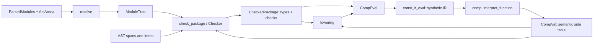

# analyzer

Turns parsed items into a checked package, and answers the compile-time
questions the checker and the lowering both ask. It reads the AST and
interned IR types; it never reads source bytes. `pipeline` owns the call
order and `lowering` consumes what this module produces.

## The pieces

There is one evaluator. The checker reaches it while its tables are still
in progress; the lowering reaches it from the finished package. Both pass
non-owning views as `CompInputs`, so neither copies the checked data.

## Checking a package, in order

1. `resolve_modules` builds a `ModuleTree` from the parsed modules and
   resolves imports. Module membership comes from the caller, never from
   source items, so no new files enter the compilation. Value and type
   expressions are not resolved here.
2. `check_package` first validates the tree (`ANALYZER_INVALID_MODULE_TREE`)
   and the arena, then `Checker` resolves every type position to an
   interned `TypeIdx` and checks bodies. Its result is a `CheckedPackage`.
3. Items the checker cannot finish on first sight - a const initializer,
   a type-level query, a comp body - go through `CompEval` below. The
   answer is spliced back as an operand or a checked type; there is no
   second pass over the source.

`Checker` lives in `checker.h`, which only the analyzer's own translation
units include. It is checking state, not public API.

## Compile-time evaluation

`CompEval` owns the quota, depth and failure state. Its two callers are
`types.cc` (the checker's `const_int_value`) and `Lowerer::Comp` (every lowering
comp site). Both reset the quota and call depth; `evaluate_item` runs in item
scope with no caller bindings, while `evaluate` carries them.

`const_ir_eval` does the work:

1. `EmitContext` bundles the checked-table callbacks (expression type,
   path, layout type, comp fn, field and variant resolution) so the
   recursive emitters do not thread them through every call.
2. `evaluate_const_ir` borrows a `StorageBuilder` and emits one synthetic
   function for the expression. Control flow, aggregates, paths, casts,
   variadics and string intrinsics become IR instructions; strings,
   aggregates and other compile-time values live in a side table; a
   `CompValue` opcode makes one visible and `tag_register` writes its
   semantic tag.
3. `interpret_function` runs the synthetic function. An IR failure carries
   its instruction index; expression ranges recorded during emission map
   that index back to the source span, then `CompEval` turns it into the
   diagnostic its caller expects.
4. `builder.rollback(cp)` removes every table entry the emission added
   and rebuilds the indexes derived from the surviving type table. Nothing
   const-only reaches the published artifact, and no re-interning from AST
   is needed. Ownership leaves the builder only through `take_state`; the
   checked tables and comp side table are borrowed views.

## Entry points

- `resolve_modules(root, modules, package_name, ast, bag, prelude,
  std_hints, dependencies, package_policies, profiler)` ->
  `base::Result<ModuleTree, diag::Reported>`. The caller owns the items,
  paths and arena and keeps all three alive for the call; failures leave
  the tree unusable and the bag holds the diagnostics.
- `verify_module_tree(tree)` -> `base::Result<void, ModuleTreeError>`:
  non-empty, root in range, no null modules, prelude count within range,
  module roots covering the modules, package roots naming modules the
  tree holds. Pure.
- `check_package(tree, width, ast, bag, strings, std_hints, profiler)` ->
  `base::Result<CheckedPackage, diag::Reported>`. Validates the tree and
  arena before any pass runs, so hand-built trees fail with a diagnostic
  instead of UB. `strings` is the compilation's interner: the storage
  returned holds ids into it, and lowering and codegen read them back.
- `CompEval::evaluate` / `evaluate_item` -> `bool`. A false answer leaves
  the reason in `failure_kind()`, `failure_span()` and `failure()` rather
  than reporting it, so the caller chooses its own diagnostic.

## Input requirements

- `CheckedPackage::types` is proof-carrying `ir::VerifiedStorage`:
  verified when the checker built it. Lowering reseeds from the proof
  instead of re-verifying.
- Pointer width is passed explicitly, never sniffed from the host.
- One `AstArena` serves the whole package; per-file arenas would dangle
  through `ModuleNode::items`.
- `CompInputs` is a set of views. The checked tables and the AST must
  outlive every `CompEval` built from them.

## Module map

| Header | Role |
| --- | --- |
| `resolve` | module tree, imports and its verifier |
| `types`, `types_*` | type interning, checking and the `CheckedPackage` |
| `checker` | private checking state, owned by the analyzer's own files |
| `comp_eval` | shared quota, failure state and callbacks for both callers |
| `const_ir_eval` | synthetic IR emission and rollback for one expression |
| `fmt` | format-string parsing for `comp_pieces` |
| `summary` | a library's exported surface spelled into the AST |
| `diag_code` | this component's diagnostic ids |

## Outside this module

`pipeline` calls resolution and checking; `lowering` consumes the checked
package and owns the other half of the comp path. `comp` interprets the
synthetic IR, `ir` owns the storage the emitter borrows, `ast` owns the
arenas, and `diag` turns this component's ids into reported diagnostics.
The pipeline contract lives in `src/docs/architecture.md`; language rules
live in `docs/spec/`.
