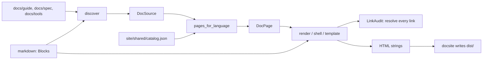

# ssg

The site generator's library. It turns a set of Markdown sources and one
catalog into the HTML of every language tree. It does not write files or
compile example fences; `src/docsite/` does both and owns the build order.

## The pieces

## One page, in order

1. `discover_*` reads a source and returns a `DocSource`: its path under
   `docs/`, its route in a tree, its title, and its parsed `Blocks`. The guide
   walks `docs/guide/<lang>/` for every catalog language; the reference and
   tools read one language-agnostic set.
2. `pages_for_language` selects one source per route for a tree. The default
   language defines which pages exist; a translation replaces its counterpart
   where one exists. Spec and tools sources are shared unchanged.
3. `render` builds the article, its heading anchors and outline, the pager,
   and the tree index. `shell` stamps the header menu and `template` stamps
   the landing and playground pages, all from the catalog.
4. `links` resolves every link before it reaches the HTML: page links become
   relative `.html` links, repository Markdown a GitHub URL, and a missing
   target an error `docsite` reports after the pass.
5. `docsite` writes the strings under `dist/` and compiles each `alcy` fence.

## The two source layouts

- `docs/guide/<lang>/NN-slug.md`: one directory per language, all equal. Only
  the default language (`en`) is special as the fallback. A missing
  translation falls back; a translation whose path has no default counterpart
  is a build error.
- `docs/spec/` and `docs/tools/`: one language-agnostic source set, published
  in every tree. The number orders the contents page; the slug is the URL.

## Module map

| Header | Role |
| --- | --- |
| `catalog` | loads and validates the JSON catalog; translates keys |
| `discover` | finds sources and their order; rewrites sibling references |
| `documents` | `DocSource`, `DocPage`, and the per-language selection |
| `markdown` | the small Markdown subset the site is written in |
| `links` | the link audit and URL resolution |
| `render`, `shell`, `template` | page markup, the shared chrome, stamped templates |
| `paths`, `urls` | route spelling and canonical/social URLs |
| `highlight` | build-time tree-sitter highlighting |

## Changing the site

- **A guide page:** add `NN-slug.md` to `docs/guide/en/`; translations go at
  the same path under another language.
- **A language:** add it to `catalog.json`'s `languages` and `names`, and a
  complete message table; `tools/catalog.py` regenerates the browser modules.
- **A label:** add the key to every message table in `catalog.json` before
  using it in code or a template.

## Outside this module

`src/docsite/` writes files, compiles fences, and builds the search index;
`site/shared/` and `site/playground/` are the browser runtime; tests live in
`src/tests/ssg/`.
